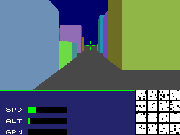
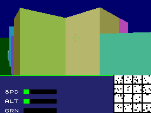
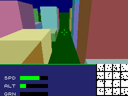

# Z-Police

A 3D vector graphics flight game for the ZX Spectrum Next, written in Z80N
assembler. You fly a VTOL craft around a city of 32×32 blocks, in the spirit
of *Sky Ranger*. Buildings fill whole grid cells, so the city is solid blocks
between one-cell-wide streets. Buildings are drawn as white vectors over solid faces, each
building in its own shaded colour, with true hidden line removal, on Layer 2 at
256×192 with 256 colours. The 3D view uses the top two thirds of the screen
(256×128), and the bottom third is an instrument panel.

  

## Building and running

Requirements: sjasmplus 1.20+ (built with Z80N support) and Python 3. To run
it, use CSpect or real Next hardware.

```
build.bat          # gentables.py -> tables.inc, then sjasmplus -> zpolice.nex
build.bat run      # ...and launch CSpect
```

Manually:

```
python gentables.py
sjasmplus --zxnext zpolice.asm
CSpect.exe -w3 -zxnext -s28 zpolice.nex
```

### Build options
These are set with `DEFINE` near the top of `zpolice.asm`, or with `-D` on
the sjasmplus command line:

| Option | Default | Effect |
|--------|---------|--------|
| `DRAW_LINES` | off | outline building faces in white |
| `WAIT_FOR_VBLANK` | off | flip buffers only in vertical blank (no tearing, slower) |
| `DRAW_FPS` | off | measure and show frames per second on the ULA |
| `SKY_IS_WALL` | on | fill the sky in the perimeter wall's colour and draw the wall only up to camera height, below |
| `LEVEL_FAST_PATH` | on | shortcuts for level flight (pitch 0), below |
| `OCCLUSION_CULL` | on | in level flight, skip buildings completely hidden behind nearer ones, below |

**`OCCLUSION_CULL`:** at street level most buildings in view end up
completely hidden behind the ones lining the street. Measured before this
option, they took 31–47% of the frame, yet the painter's algorithm still
transformed, clipped and filled them. In level flight every screen column is
a vertical slice of the world through the camera, which allows a cheap,
exact test:
* **Front to back:** the cells are walked in exactly the reverse of the
  painter's order (`occ_cells`). Each half row starts from the same cell
  and steps the same way, so the coordinates are bit-identical.
* **Cover buffer:** `OCC_YBUF` (256 bytes) holds, for each column, the row
  from which the screen is known to be covered down to the ground.
* **Test before the transform:** `occ_pretest` estimates a building's screen
  box from its cell centre, a circle of radius 188, its height, and the
  nearest and farthest depth, widened by a pixel. If every column of that
  box is already covered from its top down, the building is dropped before
  any transform.
* **Exact test after the transform:** otherwise, after the transform, the
  same test runs on the exact corners of the faces that will be drawn
  (`occ_record`). A hidden building is still dropped. A visible one lowers
  the cover to its lowest top corner across its columns. Its corners
  (9 of each 16 bytes) and face settings go into a 256-byte record.
* **Draw back to front:** the kept buildings and the cells with zombies
  are then drawn in painter's order (`occ_draw_list`). `draw_face` reads
  corners from the record via `vtx_hi`.
* **Memory:** records, the cover buffer and the list live in pages 6–7 at
  `$4000–$5FFF` (`PAGE_OCC0`), with room for 30 records. Flights have
  used at most 20. If they ever run out, that frame is drawn the plain way.
* **When it runs:** only in level flight. With the nose pitched the plain
  painter's path runs unchanged.

Why it can't hide something visible:
* Buildings that share a column reach the test front to back; the grid
  order guarantees this.
* The camera is above the ground, so anything behind sits higher on the
  screen.
* Each cover row is the lowest top corner, which underestimates the cover.
* Screen bounds are clamped inwards.
* A building with a corner behind the camera is never dropped and never
  used as cover.

To make the claims hold to the pixel, vertices the clipper puts on a screen
edge plane are now pinned exactly to that edge: row 0, row 127, column 0 or
column 255. Before, projection rounding could leave them one pixel inside,
which showed slivers of farther buildings along the top row.

With occlusion on and off, 300 frames of six flights and 42 frames of seven
views are pixel-identical. Frames per second, off → on:

| Run | Off | On |
|-----|-----|----|
| Street flight | 14.75 | 18.29 |
| Turning flights | 14.78 / 14.15 | 17.22 / 18.96 |
| Climb to the ceiling, then fly / then turn | 13.62 / 13.34 | 18.02 / 16.61 |
| Pitching flight (mostly pitched) | 13.81 | 15.00 |
| City centre, fixed views | 12.33 / 12.69 / 12.18 | 18.28 / 17.48 / 15.88 |
| Facing the wall (little to hide) | 30.60 | 27.43 |

**`SKY_IS_WALL`:** the ceiling (`MAX_Y`, 1.5) is far below the perimeter
wall (7.0), so the wall rises above the horizon in every direction.
* The sky fill uses the wall's colour (`WALL_FAMILY`, base shade), and
  includes the horizon row itself. At the horizon it is all distant wall,
  and this also hides a 1-row rounding gap when pitched.
* Wall cells are drawn as buildings of height `cam_y`. A point at camera
  height always projects onto the horizon, at any pitch, so only the strip
  of wall below the horizon is filled.
* All of a wall cell's sides use the base shade, to match the fill.
* No real sky is ever seen.

| View (fixed, 3 frames) | Off | On |
|------|-----|----|
| Facing the wall, 2 cells away | 34.0 fps | 46.3 fps |
| Facing the wall, 3 cells away | 21.5 | 30.7 |
| Diagonal towards the wall | 17.2 | 23.3 |
| Near the ceiling, facing the wall | 20.3 | 25.3 |
| Nose up / nose down, facing the wall | 14.9 / 17.0 | 21.4 / 22.2 |
| City centre (wall out of draw range) | 12.45 | 12.39 |

With `DRAW_LINES` on, the wall's top edge is outlined along the horizon.

With no roll and pitch at 0, a vertical building edge has the same camera X
and Z all the way up. `LEVEL_FAST_PATH` uses that in two places:
* **Corners:** each top corner reuses the screen x and 1/Z of the bottom
  corner below it, and only works out its own screen y.
* **Clipper:** where a vertical edge crosses the top or bottom of the view,
  the crossing point is simply (X, ±0.5Z, Z). It needs no divide and no
  interpolation. Vertical edges can't cross the near or side planes at
  pitch 0, so that covers every crossing they make.

Separately, at any pitch, building corners that pass through the clipper
unchanged and are already on screen reuse their cached projection, rather
than being projected again.

The images are identical with or without these. Measured over 50 frames,
compared with the corner-only fast path:

| Flight | Before | Now |
|--------|--------|-----|
| Level, street height | 14.61 fps | 14.94 fps |
| Level, at altitude | 13.38 fps | 13.80 fps |
| Pitching down and back to level | 13.88 fps | 14.13 fps |

Over a 20-frame street flight, 237 of 688 clip intersections skip the
divide, and 385 projections are replaced by cached ones.

## Main menu (`menu.asm`)
After start-up the game shows a main menu:

| Key | Option |
|-----|--------|
| 1 | **New game**: starts level 1 (`newGame` in `zpolice.asm`) |
| 2 | Save game (not yet) |
| 3 | Load game (not yet) |
| 9 | Redefine keys (not yet) |

**Game over:** when the landing pad is destroyed, the main loop goes to
`game_over_screen` (`menu.asm`). It shows GAME OVER for `GAME_OVER_FR` (500)
video frames, 10 seconds, and then returns to the main menu. The menu
times frames from the raster line. It reads NextRegs `$1E`, `$1F`, `$1E`
and retries if the high byte changed, because a read straddling line 256
would otherwise look like line 0 and end a frame early.

* **Drawing:** the menu is in its own page (`PAGE_MENU`, page 8, at
  `$E000`). It's drawn on the ULA screen with opaque paper, with Layer 2
  hidden, using an 8×8 font generated by `gentables.py` (`tables_font.inc`:
  space, digits, A–Z, `. - :`).
* **Seeding:** each frame it waits for the next video frame and calls the
  random number generator (`zrand`). It's seeded once from the R register
  at power-on. How long you wait before pressing a key changes where the
  zombies and humans are placed: a different wait gives a different
  layout.
* **Start-up vs `newGame`:** start-up sets the hardware once: 28 MHz,
  Layer 2 mode, clip window, layer priority, memory map, both palettes and
  `$68`. The menu leaves those alone, so they aren't redone. `newGame`
  resets everything else, so it also works for a second game:
  * the player state from `start_state`: position on the base pad,
    heading, pitch, speed, weapon slots, selected slot, slot flash;
  * no rounds or laser beam, the gun and laser timers, `level` =
    `START_LEVEL`, `salvage_points` = 0 (a 16-bit score, not used yet);
  * both Layer 2 buffers cleared and Layer 2 made visible again;
  * the ULA panel and the city map (`ula_init`, which also makes the HUD
    redraw its passenger and weapon rows);
  * zombies (with the cell lists cleared) and humans (passengers and
    saved = 0).

## Controls

| Key | Action          | Key | Action          |
|-----|-----------------|-----|-----------------|
| Q   | speed up        | A   | slow down / reverse |
| Z   | stop            |     |                 |
| O   | turn left       | P   | turn right      |
| W   | climb           | S   | descend         |
| E   | nose up         | D   | nose down       |
| SPACE | fire the selected weapon (hold) | 1–5 | select weapon slot: 1 = centre, 2–5 = wing pylons |
| 0   | cycle the centre slot's weapon: machine gun / pulse laser / chain gun | | |

**Keyboard (`keys.asm`):** the keys are redefinable. The game asks about
*actions* (`K_FIRE`, `K_LEFT`, …), and `key_defs` holds the key for each.
* **Key codes:** a key is a 16-bit code (`KB_Q`, `KB_UP`, …): the key bank
  in the high byte, the bit mask in the low byte.
  * Banks 0–7 are the ZX Spectrum half-rows (port `$xxFE`, address line
    A8+bank low): `$FEFE` SHIFT Z X C V up to `$7FFE` SPACE SYM M N B.
    These read 0 = pressed.
  * Bank 8 is NextReg `$B0`, Extended Keys 0: RIGHT, LEFT, DOWN, UP, `.`,
    `,`, `"`, `;` (bits 0–7).
  * Bank 9 is NextReg `$B1`, Extended Keys 1: EXTEND, CAPS LOCK, GRAPH,
    TRUE VIDEO, INV VIDEO, BREAK, EDIT, DELETE.
  * The extended banks read 1 = pressed.
* **Scan:** `kbd_scan`, at the top of the main loop, reads all ten banks
  into `key_now`, keeping the previous scan in `key_prev`. It inverts the
  ZX rows, so every bank holds 1 = pressed.
* **Tests:** `key_held` (A = action) is NZ while its key is down.
  `key_pressed` is NZ only on the frame it goes down.
* **Redefining:** `key_define` (A = action, HL = key code) changes an
  action's key. `key_find` returns the code of any key being held, for a
  future redefine screen.
* **Doubling:** the Next normally also enters the extended keys into the
  ordinary rows (cursor LEFT shows up as CAPS SHIFT + 5).
  * `kbd_double_on` stops this: it sets `KBD_STOP_DOUBLING` to `TRUE` and
    NextReg `$68` bit 4 to 1.
  * `kbd_double_off` (alias `kdb_double_off`) sets it back to `FALSE` and
    bit 4 to 0. That's the default, applied at start-up.
  * Both keep `$68`'s other bits.

The craft moves horizontally along its heading. Pitch only aims the view, as
for a hovering VTOL, and height is set with W/S. A gunsight marks the
centre of the view. At the left of the panel below are two vertical
gauges, filled from the bottom:
* **S:** speed, turning red when reversing.
* **A:** split in two. The left half is the altitude (green). The right
  half is the height of the city tile under the craft (amber), on the same
  scale, and is empty over a road. The gap between the two tops is your
  clearance.

**The VTOL:** the player's craft is 10 m long and 3 m wide (`VTOL_LEN_M`,
`VTOL_WID_M`). Its position (`cam_x`, `cam_z`, the camera) is its centre.
* **Hit box:** the 10 × 3 m rectangle, turned to the heading
  (`vtol_ground`). Six points are tested: the four corners and the middles
  of the long sides (half length `VTOL_HL` 64 units, half width `VTOL_HW`
  19). The rectangle is smaller than a tile, so these find every cell it
  overlaps, except for a tile corner just nicking a long side.
* **Collision:** if any of those points is over a roof less than `COLL_H`
  (12 units, 0.94 m) below the camera, the VTOL stops, the border flashes
  red, and the position and heading go back to the last frame's. The
  heading is restored too, because turning swings the nose and tail.
Turning (O/P) moves 1.5 angle units per frame (`YAW_RATE`, 8.8 fixed point,
256 units = 360°).

**Pitch damper:** with neither E nor D held, the nose eases back to level.
Pitch is a signed 8.8 value (`pitch_frac`/`pitch`). The renderer uses only
the whole part, so the level fast path still applies once it reaches 0.
* Every `PDAMP_FRAMES` (4) frames, the pitch moves towards 0 by
  `max(PDAMP_MIN, |pitch|·PDAMP_K)`. That is about 1/6 of what is left,
  but never less than 1/8 of a unit.
* The steps shrink as the nose nears level, so it slows down as it gets
  there. It never overshoots, and it stops exactly at 0.
* From full pitch (±24) it takes 111 frames to level, about 8 seconds at
  14 fps. It goes 24 → 11.7 → 5.9 → 3.0 → 1.7 → 1.0 → 0.5 → 0, one value
  every 16 frames.
* The step is calculated with the Z80N `MUL` rather than read from a table.
  It's just as fast, and the curve stays adjustable through the equates.
* While E or D is held, pitch moves in whole steps as before, and the
  damper waits a full interval after the key is let go.

### The base
The player's base is a 7×7 central plaza (`PLAZA` in `gentables.py`),
laid over the normal city layout as near the city's centre as the grid
allows.
* **Position:** the centre is the corner between cells 31 and 32, so the
  plaza covers cells 29–35 on both axes. It sits on the crossing of the two
  middle boulevards, which open onto it from all four sides.
* **Layout:** it's all open road (level 0) except the centre cell, (32,
  32). That cell is the landing pad: map code `PAD_CODE` (16), 0.5 height
  units (`PAD_H`, 64 units, 5 m) high, in colour family 63, which is reserved and
  white.
* **Terrace:** around the pad, every cell 1 or 2 tiles from it
  (`TERRACE_R`, the 5×5 square less the pad) is a green terrace: map code
  `TERRACE_CODE` (17), 0.25 height units (32 units) high, in colour family 62,
  which is reserved and green. Ordinary buildings use families 0–61. The
  plaza's outer ring, 3 tiles out, stays road, so the streets still join up
  round the base. The terrace can be landed on like any low roof.
* **No humans on the base:** humans never spawn on the pad or the terrace
  (any map code 16 or above).
* **Pad height:** `htab` has the pad's and the terrace's heights as
  entries 16 and 17, so `bld_height` (masking 5 bits) handles them like
  any building. The pad
  shows white on the map.
* **Start:** you start landed on the pad (`PAD_X`, `PAD_Z`), facing north
  up the middle boulevard (`BASE_YAW` = 0).
* **Disembarking:** when landed on the pad (speed 0, resting on it), the
  passengers get off one every `DISEMBARK` frames (1 s at 14 fps). Each one
  counts as `saved`. The first gets off a second after landing.

### Landing and rescuing humans (`human.asm`)
Inspired by *Defender*: humans wait around the city to be picked up.
* **Humans:** there is room for `HUMAN_MAX` (20), and `nhumans`
  (`HUMANS_INIT`, 5) are placed at random at start-up, never on the
  perimeter wall.
  * They stand on a road, or on a roof no taller than `HUMAN_ROOF_MAX` =
    `MAX_Y` − 1.0 height unit. With the ceiling at 1.5 height units
    (15 m), that's 0.5 (5 m), so only level-1 roofs (4.7 m).
  * They never move unless being rescued.
  * They're drawn as white stick men (`HUMAN_COL`), always facing you,
    waving their right arm (4 frames, a new one every 4 frames).
* **Map:** each human is a blue dot (`HUMAN_BLIP`), flashing 3 frames on
  and 3 off, written into the Layer 2 map like the zombie blips.
* **Landing:** descending stops at the floor under the VTOL (`floor_y`):
  `MIN_Y` (0.6 m) when its whole footprint is over road, or just clear,
  `COLL_H` + 1 (about 1 m), of the highest roof under any part of it. Setting down there isn't a collision, so
  there's no border flash. You're *landed* when speed is 0 and you're
  resting at that height.
* **Rescue:** every frame (`human_update`), while landed and carrying fewer
  than `PASSENGER_MAX` (5), each human checks two things. It must be at
  the same height as the floor under the craft: the road with the road, a
  roof with a roof of the same height. And it must be within `RESCUE_R`
  (2.0 tiles, 20 m, by a max + 3/8 min distance estimate).
  * A human that passes both runs straight to the craft at 10 m/s
    (`HUMAN_RUN`, 18 units a frame at 14 fps; about 17 after rounding).
  * When it gets there it climbs in: `passengers` goes up by one, and its
    dot and figure go.
  * A human on a roof can't reach a craft on the road, or on a roof of a
    different height. When the craft is full, nobody runs.

**Drawing:** zombies and humans share one figure drawer (`fig_draw` in
`zombie.asm`). It takes the feet's height (`fig_y`), a frame chooser
(`fig_sel`) and a patched colour.
* `hum_here` checks a 64×64-bit table (`hum_bits`) to see whether a cell
  holds humans.
* In a street cell, humans are drawn after its zombies. On a building,
  they're drawn after the building, so the roof doesn't cover them.
* With `OCCLUSION_CULL`, the cell goes on the draw list as its `city_col`
  address (`$6000–$6FFF`), listed before the building so it's drawn after
  it.
* The humans' code, sprites (`tables_human.inc`) and records sit in page 7
  at `$7000`, which is always mapped.

**Not yet:** shots don't hit humans.

### Weapon slots
The helicopter has 5 weapon slots, held in `wpn_slots` in the resident
player state as 2 bytes each: a type byte, then an ammo counter byte.
* Slot 0 is the centre gun. It starts as `WPN_GUN` with infinite ammo.
* Slots 1–4 are the wing pylon hard points, which have limited ammo.
  Slot 1 starts with a rocket pod (`WPN_ROCKETS`, 12 rockets); the others
  start empty (`WPN_NONE`, 0).
* An ammo counter of 255 (`AMMO_INF`) means infinite ammo and is never
  counted down. 0 means empty.
* The types are `WPN_NONE` 0, `WPN_GUN` 1 (machine gun), `WPN_LASER` 2
  (pulse laser), `WPN_CHAIN` 3 (chain gun) and `WPN_ROCKETS` 4 (rocket
  pod). The placeholders `WPN_MISSILE` and `WPN_BOMB` are 5 and 6. They are defined at
  the top of `zpolice.asm`.
* Keys 1–5 select which slot SPACE fires (`wpn_sel`): 1 is the centre
  slot, 2–5 the pylons. The guns, the laser and the ammo count use the
  selected slot. An empty slot (`WPN_NONE`) can't be selected; the HUD
  flashes it instead. Changing slot stops any laser beam or cool-down.
* For testing, key 0 cycles the centre slot: machine gun → pulse laser →
  chain gun → machine gun, once per press. All three have infinite ammo
  for now. Limited ammo counts down one per round (`take_ammo`).

### Machine gun (`weapons.asm`)
The gun is the centre slot's `WPN_GUN`, with infinite ammo (`AMMO_INF`).
`weapons.asm` is its own code page (`PAGE_WEAPONS`, page 4, at `$E000`),
run each frame after the zombies move.
* **Firing:** hold SPACE to fire one round every `GUN_INTERVAL` (4) frames.
  Up to `NBULLETS` (20) rounds, shared with the chain gun, can be in
  flight.
* **Path:** rounds leave the ship's centre line 0.5 m below the camera
  (`GUN_DY`). They fly straight along the view direction, including pitch,
  at 500 m/s.
* **Speed per frame:** like every other speed, this is applied per frame,
  at the nominal 14 fps (`NOMINAL_FPS`): `BULLET_STEP` = 457 units, 36 m
  per frame.

**Collision:** each frame a round's path from its old position to its new
one is walked cell by cell through the grid, in order. The walk is a 2D DDA
on the horizontal distance along the path. The first thing met ends it:
* **Building cell:** a wall hit where the path enters the cell below the
  roof, or a roof hit where it drops below the roof. These use the real
  heights, so the perimeter wall is 70 m even with `SKY_IS_WALL`.
* **Street cell:** the zombies standing in it, from the cell lists. Each is
  a box 0.5 m wide and 2 m tall (`ZHIT_R`, `ZHIT_H`), tested by distance
  along and across the path. The nearest along the path is hit.
* **Ground:** where the path reaches height 0.
* **Map edge:** a round that leaves the 64 × 64 map is simply removed.

A round that hits is moved to the impact point, drawn there once, then
freed. A zombie that is hit loses the round's damage (see *Damage*
below); when its hit points run out it is killed: its map blip is removed
and its record made inactive.

**Tracers:** `draw_bullets` in the city page draws, for each round, a line
along the path it covered this frame: from where it started (`B_PX..`) to
where it is now. It uses `BULLET_COL`, over the city and before the
gunsight.
* **First frame:** a fresh round's path starts at the muzzle, 0.5 m below
  the camera, which is below and behind the view. The line's start is
  moved along it to where it enters the view (`bul_clip`) and pinned to
  the screen edge it crosses, as the face clipper does. Each shot therefore
  rises from the bottom row (127), as if fired from under the craft. The
  chain gun's half-stepped round keeps its muzzle start too.
* **Later frames:** the path is far ahead and seen almost end-on, so it
  shows as a dot near the centre.
* **Skipped lines:** a line whose end is outside the view isn't drawn.
* **Speed:** shots fly along the view direction, so any speed gives the
  same picture: a line from the bottom edge towards the centre on the
  first frame. The 500 m/s is kept.

### Zombie bursts
A zombie that is killed, by gun, laser or rocket, sprays `NPART_BURST` (10)
particles from its body, 1 m up (`PART_Y`).
* **Motion:** each particle gets a random velocity: sideways −8…7 units a
  frame in x and z, and 3…10 up. Each frame it moves by that velocity,
  gravity (`PART_GRAV`, 2) takes off upward speed, and it stops on the
  ground. So the spray rises to about 2 m, spreads about 3.5 m, and falls
  back.
* **Colour:** it starts bright green and gets darker every frame:
  `PART_COL0`…`PART_COL7`, palette entries 59–87, from (1,7,1) to (0,1,0).
  After `PART_LIFE` (8) frames it is removed.
* **Pool:** particles are kept in a resident pool of `NPART` (40), room for
  4 bursts at once; a burst uses whatever is free. `part_update` (in
  `update_weapons`, before firing) ages and moves them. `draw_particles` (in
  the city page, after the tracers) draws each as one pixel over the city.
  `newGame` clears them.

### Chain gun
Weapon type 3 (`WPN_CHAIN`), in the centre slot. It's the machine gun at 4×
the rate of fire, with a random spread.
* **Rate:** one round every `CHAIN_INTERVAL` (1) frame while SPACE is
  held, against the machine gun's one every 4.
* **Spread:** each round's heading and climb are each turned by a random
  −`CHAIN_DEV`…+`CHAIN_DEV` (9) steps of 1/256 rad, about ±2°.
  * The heading is rotated by `(sin, cos) += d/256 · (cos, −sin)`, rounded
    (`dmul`). The climb adds `d` to the slope (tan).
  * Measured over 200 rounds heading along an axis: −2.01°…+2.01° each way,
    all 19 steps used. At a 45° heading the stored direction is coarser:
    ±1.9° sideways, in 13 distinct values.
* Everything else (500 m/s, collisions, drawing) is shared with the
  machine gun.

**Performance:** the distance a round travels between cell boundaries
depends only on its direction. It is worked out once, with two divides, on
the round's first step and kept in the round (`B_TDX`, `B_TDZ`). Each
frame's first boundary is then a hardware `MUL`, not a divide.

| Firing (street, 30 frames) | fps |
|-----------------|-----|
| Nothing | 21.5 |
| Pulse laser | 21.4 |
| Machine gun | 21.0 |
| Chain gun | 19.9 |

Most of the chain gun's remaining cost is projecting up to 20 tracers a
frame.

### Pulse laser
Weapon type 2 (`WPN_LASER`), in the centre slot, with infinite ammo.
* **Firing:** hold SPACE. The beam is on for `LASER_ON` (3) frames, then
  cools for `LASER_COOL` (8) frames, and repeats while SPACE is held.
  That's 0.1 s and 0.25 s as specified at 30 fps; at 14 fps it is 0.21 s
  and 0.57 s.
* **Hitting:** each beam frame, the beam is traced from the muzzle along
  the current view direction with the machine gun's grid walk, so it
  follows the aim. The range is `LASER_RANGE` (120 m, the draw distance).
  It stops at the first building, ground or zombie, and does 1 damage
  to a zombie it reaches on each beam frame.
* **Drawing:** the beam is kept in `laser_rec` in the same form as a round
  (state 3), with its path running from the muzzle to where it stops. So
  `draw_bullets` draws it the same way, as a red line (`LASER_COL`) rising
  from the bottom row of the view to the end of the beam.

**Note:** in level flight from the start (landed on the pad, camera 6 m
up), the muzzle is 5.5 m up, so rounds pass over the zombies' 2 m boxes. Fly lower or pitch
the nose down to hit them. The same applies to the laser.

### Rocket pod
Weapon type 4 (`WPN_ROCKETS`), on a wing pylon. A pod holds 12 rockets
(`ROCKET_SHOTS`); slot 1 has one at the start, so key 2 selects it.
* **Firing:** hold SPACE for one rocket every `ROCKET_INTERVAL` (7) frames.
  Each uses one of the pod's ammo.
* **Flight:** rockets are rounds in the `bullets` pool, marked by `B_KIND`
  = `BK_ROCKET`. They fly straight along the view direction at 150 m/s
  (`ROCKET_STEP` = 137 units a frame at 14 fps), with the machine gun's
  grid walk and collisions.
* **Drawing (`draw_rocket`):** a white streak (`ROCKET_COL`) from the head
  1 m back along its path (`ROCKET_LEN`), then a yellow trail
  (`TRAIL_COL`) to 1.5 m behind the head (`ROCKET_TRAIL`). Both are real
  lengths, projected. Up close that's a short line of a pixel or two, and
  further off a single white pixel. The yellow is drawn first, so the white
  stays on top.
* **Blast (`rocket_blast`):** wherever a rocket stops (a building, the
  ground or a zombie), it bursts. Everything within `BLAST_R` (5 m, 64
  units) of the burst on each of the x, y and z axes takes `BLAST_DMG` (20):
  * zombies (height measured from their feet);
  * humans waiting to be rescued. They have `HUMAN_HP` (10), so a blast
    kills them, removing their figure and map dot;
  * the base tiles: the terrace and the landing pad. Each tile the box
    overlaps is hit if the burst is no more than 5 m above its top.
    Destroying the pad ends the game, as when zombies destroy it.

  It's a box test, not a sphere: anything more than 5 m away on any one
  axis is skipped, using plain integer compares. A direct hit does no extra
  damage; the blast does it all.

### Damage
Weapons do damage in hit points:

| Weapon | Damage |
|--------|--------|
| Machine gun (`GUN_DMG`) | 4 per round |
| Chain gun (`CHAIN_DMG`) | 2 per round |
| Pulse laser (`LASER_DMG`) | 1 per beam frame on a target |
| Rocket blast (`BLAST_DMG`) | 20 to everything in range |

* **Rounds:** each round carries its damage in `B_DMG`. `zdamage` takes
  it off the zombie and kills the zombie at 0.
* **Hit points:** zombies keep theirs at +18 of their record. On level 1
  a zombie has `ZHP` (5) and a fast zombie `ZHP_FAST` (4).
  * The machine gun kills a zombie in 2 rounds and a fast zombie in 1.
  * The chain gun takes 3 rounds, and the laser 5 beam frames.
  * Humans have `HUMAN_HP` (10). The terrace tiles have `TERRACE_HP`
    (100) and the pad `PAD_HP` (200), each taking 20 from a blast and 1
    from a zombie's blow (`base_damage`).

### Instrument panel (ULA / Layer 1)
The panel in rows 128–191 is drawn on the ULA, which is above Layer 2
(priority S-U-L). Layer 2 shows through only where the ULA cells are made
transparent: the city map, the compass and the gauges.

* **Fixed contents:** set up once by `ula_init`. That's a dark slate paper,
  a green divider on the top pixel row, and the gauge labels "S" and "A".
* **Gauges:** two vertical bars at the left, `GAUGE_H` (48) pixels tall
  (pixel rows 136–183, character rows 17–22), filled from the bottom and
  labelled on row 23.
  * **S** (speed) is 8 pixels wide in character column 1 (`SPD_GCOL`). It
    is (speed × 55) / 32 pixels, so `SPEED_MAX` 28 fills it. It's green,
    or red when reversing.
  * **A** shares character column 3 (`ALT_GCOL`). The left 4 pixels are the
    altitude (green), and the right 4 the height of the city tile under the
    craft (amber, `GAUGE_AMBER`), read via `cam_cell_ptr` and `bld_height`.
    Both are 1 pixel per 4 world units, so the 15 m ceiling (`MAX_Y` 192)
    fills the bar. The ground under the craft is always lower than the
    craft, so it never overflows.
  * **Why Layer 2:** the two halves of A need green, amber and black in one
    8×8 cell, which ULA attributes can't do. So the bars are drawn on Layer
    2 behind transparent ULA cells (attribute 0), like the compass.
    `draw_gauges` writes the 48 rows into the back buffer every frame.
* **Passengers:** on the panel's top row (character row 17, `PAX_ROW`,
  from column `PAX_COL` 5) is a
  row of `PASSENGER_MAX` (5) 8×8 cells, one per seat. From the left:
  * a green stick man for each human saved (delivered to the base);
  * a white stick man for each human aboard;
  * a hollow 6×6 square for each empty seat.

  `draw_pax` redraws the row only when `passengers` or `saved` changes.
* **Weapon slots:** to the right of the passengers, `WPN:` (column
  `WPN_LBL`) then the digits 1–5 (from column `WPN_COL`). Each digit is
  green if its slot holds a weapon and light blue if it's empty.
  * The selected slot's digit has a box drawn round it, in its own 8×8
    cell; the digits keep clear of the cell's edge. When the selection
    changes, the old digit is redrawn plain.
  * Asking for an empty slot (a new press of its key) doesn't select it.
    The current slot is kept, and the asked-for digit flashes yellow and
    blue, `WFLASH` (5) frames each, 3 times, ending blue.
  * `draw_wpn` sets the five colours every frame, and moves the box only
    when `wpn_sel` changes.
  * The flash state (`wflash_slot`, `wflash_t`) is resident, since the
    weapons page sets it and the HUD page shows it.
  * Yellow and light blue are ULA inks 2 and 5 (`C_YEL`, `C_BLUE`).
* **Compass:** a horizontal strip, 32×8 pixels inside a 2-pixel white
  frame, at pixel (128, 156), centred on the current heading. A red notch
  in the frame marks the centre.
  * N, E, S and W are red and NE, SE, SW and NW yellow, in a small font,
    with grey ticks underneath.
  * It's drawn on Layer 2 for per-pixel colour. The ULA cells over it
    (columns 15–20, character rows 19–20) are transparent paper. The rest
    of that window is filled with `PANEL_L2`, the panel colour as a Layer 2
    palette entry.
  * The lookup table `compass_tape` (`gentables.py`, `tables_compass.inc`)
    covers a full turn at 4 yaw units (5.6°) a pixel, with a mark every 8
    pixels (45°). It's stored 96 columns wide so any 32-column window is
    one copy.
  * Each frame `draw_compass` copies the 32 columns centred on `yaw` into
    the back buffer: 8 rows of 32 bytes. `compass_init` draws the frame
    and background once per game into both buffers.
* **City map:** the right-hand 64×64 of the panel (columns 192–255) is a
  map of the whole 64×64-cell city, one pixel per cell, with north (+Z) at
  the top.
  * The map is drawn on Layer 2, so each building pixel is the base
    colour of its building's colour family. Streets are black (`MAP_BG`),
    and the perimeter wall shows as the border.
  * Zombie blips are bright green pixels (`MAP_ZOMBIE`) written into the
    Layer 2 map.
  * The ULA attributes over the map are transparent paper with white ink,
    so Layer 2 shows through. The ULA draws only the player's flashing
    white dot on top.
  * The Layer 2 clip window covers all 192 rows. Elsewhere in rows
    128–191 the panel's ULA paper is opaque and hides Layer 2.
  * `map_init` draws the map once into both Layer 2 buffers (`map_l2`).
    The viewport clear only touches rows 0–127, so it stays.
  * Each frame, `map_player` undoes the previous frame's XOR, then on
    alternate frames XORs the pixel under the player (its cell). The
    marker flashes and leaves the map intact.
* **Paging:** the ULA screen (bank 5) stays mapped at `$8000` (slots 4–5),
  so no paging is needed for the panel or the FPS text.
* **ULA palette:** the custom entries are paper 0 = `$E3` (transparent, so
  the viewport shows through above the panel), paper 1 = panel, paper 2 =
  empty gauge, paper/ink 3 = red, paper/ink 4 = green and paper/ink 6 =
  amber.
* **Border:** the border flash on a collision uses colour 3 (red).

### Hardware sprites (`sprites.asm`, Layer 3)
Support for the Next's 128 hardware sprites. Nothing in the game uses them
yet.
* **Screen:** sprites are drawn above Layer 2 and the ULA (priority S U L).
  `sprites_init` also shows them over the border (NextReg `$15` bits 0 and
  1), so they can go anywhere on the 320 × 256 sprite screen.
  * x runs 0–319 and y 0–255. (`SPR_SCREEN_X`, `SPR_SCREEN_Y`) = (32, 32)
    is the top left of the 256 × 192 screen.
  * A position is the sprite's top-left pixel.
  * Coordinates are 9 bits and wrap at 512, so they can be negative: x = −8
    shows a sprite's right half at the left edge.
  * Where sprites overlap, the higher number is on top.
* **Patterns:** 16 × 16, one byte per pixel (8-bit), 256 bytes each, up
  to 64 in the sprite pattern memory. Byte `$E3` (`SPR_TRANS`, NextReg
  `$4B`) is transparent. The sprite palette starts as the identity, so a
  pattern byte is its own RRRGGGBB colour until `spr_palette` changes it.
* **Shadow table:** the routines change a table of the first `SPR_COUNT`
  (32) sprites' attributes (`spr_shadow`, 5 bytes each). `spr_update` sends
  it to the hardware, once a frame. The other sprites stay hidden.
* **Routines** (page 7, always mapped, so any page can call them):

| Routine | In | Does |
|---------|----|------|
| `sprites_init` | – | sprites on, over the border; all 128 hidden; table cleared (called by `start`) |
| `spr_update` | – | send the table to sprites 0 … `SPR_COUNT` − 1 |
| `spr_patterns` | HL = data, A = first pattern, B = count | load 8-bit patterns |
| `spr_palette` | HL = colours, A = first index, B = count | load sprite palette colours (RRRGGGBB) |
| `spr_set` | A = sprite, BC = x, DE = y, H = pattern, L = flags | place it, set its pattern and flags, and show it |
| `spr_pos` | A, BC = x, DE = y | move it |
| `spr_pattern` | A, E = pattern | change its pattern |
| `spr_flags` | A, E = flags | `SPRF_XMIRROR`, `SPRF_YMIRROR`, `SPRF_ROT` (90° clockwise), palette offset × `SPRF_PAL` |
| `spr_scale` | A, E = x scale, D = y scale | 0–3 = ×1, ×2, ×4, ×8 |
| `spr_hide`, `spr_show` | A | hide or show it |
| `spr_hide_all` | – | hide every sprite in the table |

**Sprite banks (`sprite_data.asm`):** pattern data is only needed while it
is loaded into the sprite pattern memory, so it's kept in its own 8K pages
rather than page 7.
* **Bank layout:** each bank is a page assembled at `$0000`. It starts
  with a 2-byte header, then its patterns (up to 31 of 256 bytes):
  * `SPRB_COUNT`: the number of patterns;
  * `SPRB_FIRST`: the pattern number the first one loads to.
* **Loading:** `spr_load_bank` (A = page) maps the bank into slot 0, copies
  its patterns with `spr_patterns`, then restores slot 0's page, read back
  from NextReg `$50`. Slot 0 is otherwise only used for paging Layer 2
  sections, so this can be called from any page, at any time.
* **Bank 0:** `PAGE_SPR0` (page 9, beside the menu's page 8) holds the
  human status sprites, and `sprites_init` loads it.
* **More sprites:** add a bank in the next free page, with its own
  `PAGE_SPRn` and a block in `sprite_data.asm`, and load it with
  `spr_load_bank`.

**Human status sprites:** bank 0 holds four 16 × 16 patterns
(`tables_hspr.inc`, from `gentables.py`), loaded as patterns 0–3. They're based on
the HUD's passenger markers, for showing what has become of each human:

| Pattern | Name | Means | Picture |
|---------|------|-------|---------|
| 0 | `HSPR_FIELD` | in the field, not yet rescued | an empty white square (the HUD's empty seat, doubled) |
| 1 | `HSPR_ABOARD` | aboard the VTOL | a white person sitting in a grey chair, side on |
| 2 | `HSPR_SAVED` | rescued | a green person standing (the HUD's man, doubled) |
| 3 | `HSPR_DEAD` | dead | a white person with a red cross over them |

They use the identity sprite palette (white `$FF`, green `$1C`, red `$E0`,
grey `$92`). Show one with, for example, `spr_set` with H = `HSPR_SAVED`.

The emulator (`tools/nexsim.py`) draws the sprites too: the ports
`$303B`, `$57` and `$5B`, mirrors, rotation, scale and wrapping. With
sprites over the border its PNGs are the full 320 × 256.

### FPS counter
The frame rate is shown as `nn FPS` in the top left of the ULA screen,
which sits above Layer 2 (layer priority S-U-L, NextReg `$15`). ULA paper
palette entries 16 and 24 are set to the global transparency colour `$E3`,
so only the white text covers the 3D view. Interrupts stay off because the
span filler borrows SP, so time comes from the raster instead:
* `vtick` reads the video line (NextReg `$1E/$1F`) and counts a new 50 Hz
  frame each time the line number goes backwards. It runs between the
  main-loop stages and once per building, so it is sampled more often than
  once per display frame.
* Every 50 display frames (one second), the number of frames rendered is
  shown.

## Files

| File | Purpose |
|------|---------|
| `zpolice.asm` | resident main code at `$C000`: start-up, main loop, per-frame setup, fixed-point maths, frame timing, shared variables and tables, stack. Includes the three pages below. |
| `city.asm` | city page (`PAGE_CITY`, runs at `$E000`): all Layer 2 drawing, with its own tables and variables |
| `hud.asm` | HUD page (`PAGE_HUD`, runs at `$E000`): all ULA (Layer 1) code, font and labels |
| `zombie.asm` | zombie page (`PAGE_ZOMBIE`, stays mapped at `$2000`): zombie records, seeding, walking, per-cell lists and the scaled sprite drawer |
| `menu.asm` | main menu page (`PAGE_MENU`, page 8, at `$E000`): menu screen, per-frame random seed stirring, starts `newGame` |
| `keys.asm` | keyboard engine (page 7 after `map.asm`, always mapped): scans the 8 ZX half-rows and the 2 Next extended-key registers each frame; redefinable action keys |
| `sprites.asm` | hardware sprites, Layer 3 (page 7 after `keys.asm`, always mapped): set-up, pattern and palette loading, a shadow attribute table and its per-frame upload, positions on the 320 × 256 sprite screen |
| `sprite_data.asm` | sprite pattern banks (8K pages from `PAGE_SPR0`, page 9, assembled at `$0000`): a count, a first pattern number and the patterns; bank 0 has the human status sprites |
| `map.asm` | the city map (page 7 after `human.asm`, always mapped): drawing it into both Layer 2 buffers, the ULA set-up over it, the player's flashing dot, zombie blips, human dots |
| `human.asm` | humans to rescue (page 7 at `$7000`, always mapped): placement, map dots, drawing, landing rescue |
| `weapons.asm` | weapons page (`PAGE_WEAPONS`, runs at `$E000`): machine gun firing, round movement and collision with buildings, ground and zombies |
| `player.asm` | player page (`PAGE_PLAYER`, runs at `$E000`): `update_player`, which handles keyboard input, movement, world-edge clamping and building collision |
| `gentables.py` | generates `tables.inc` (sine, horizon, heights, city map, Layer 2 palette) `tables_city.inc` (reciprocal, log2, used corners), `tables_col.inc` (per-cell colours, page 7) `tables_zombie.inc` (zombie sprites, sizes, bit-reverse table) and `tables_hspr.inc` (the human status hardware sprite patterns) |
| `layer2_cls.asm` | zxnDMA equates and the fill command block used by `clear_screen` |
| `tools/nexsim.py` | small headless Z80N emulator used for testing: dumps every flipped frame to PNG and counts T-states per routine |
| `build.bat` | build script |

## Memory map

```
$0000-$1FFF  one 8K section (32 rows) of the Layer 2 back buffer, slot 0
             pixel address = (y & 31)*256 + x  ->  H = y & 31, L = x
$2000-$3FFF  PAGE_ZOMBIE (page 5, ~3.2K) zombie.asm - always mapped (slot 1)
$4000-$5FFF  occlusion data (page 6, OCCLUSION_CULL)
$6000-$6FFF  city_col: cell colour families (page 7)
$7000-$7FFF  humans: code, sprites, records, hum_bits (human.asm), then
             the city map code (map.asm), the keyboard (keys.asm), the
             hardware sprites (sprites.asm), page 7
  (slot 0 also takes a sprite bank, PAGE_SPR0 = page 9, sprite_data.asm,
   while spr_load_bank copies its patterns)
$8000-$BFFF  ULA screen, bank 5 (slots 4-5): bitmap $8000, attributes $9800
$C000-$DFFF  main code, shared variables and tables, stack (page 0, ~3.3K)
$E000-$FFFF  code page, swapped with NextReg $57:
               PAGE_CITY (page 1, ~6.3K)  city.asm - Layer 2 drawing
               PAGE_HUD  (page 2, ~0.7K)  hud.asm  - ULA HUD
               PAGE_PLAYER (page 3, ~0.4K) player.asm - input/movement
               PAGE_WEAPONS (page 4, ~1.2K) weapons.asm - weapons
```

**Code pages:**
* All three pages are assembled at `$E000` (sjasmplus `MMU 7 e, page, $E000`)
  and saved into the NEX. `main_loop` pages `PAGE_PLAYER` in for
  `update_player`, `PAGE_CITY` for the clear,
  the dots, the city and the gunsight, then `PAGE_HUD` for the gauges, map
  marker and FPS text.
* Code in any page may call the resident main code. The `$E000` pages
  never call each other.
* The zombie page is the exception to swapping: it stays mapped at `$2000`
  (slot 1, set at start-up). `main_loop` calls `zombie_update` from there,
  and the city page jumps into `zombie_cell` while it draws. The zombie
  page in turn calls the city page's rotation, projection and `seg_map`.
* Variables shared between the pages (camera, view set-up, `seg_base`,
  FPS counters, `city_map`) stay in the main code. Everything else is local
  to its page.
* The stack lives in resident memory, since `$E000–$FFFF` changes
  underneath it.

Each Layer 2 buffer is three 16K banks (rows 0–191). The viewport is rows
0–127, and the city map sits in rows 128–191. Buffer A is banks 9–11 and
buffer B is banks 12–14. The buffers are double buffered with the hardware shadow register:
NextReg `$12` is the active (displayed) bank and NextReg `$13` the shadow
bank. Each frame `map_shadow` reads the shadow bank back from `$13` and
records the 8K page of its first row (`seg_base`). During the vertical blank
`l2_flip` swaps the two registers, so the registers themselves record which
buffer is which.

Layer 2 is written through MMU slot 0 only, one 8K section at a time, paged
in as drawing reaches it. Each section holds 32 rows, so row y is page
`seg_base + y/32`, and within the paged section a pixel is just
`ld h,y&31 : ld l,x : ld (hl),c`.
* `seg_map` pages in the section for a row.
* The polygon filler pages once per polygon, then again inline when a span
  row crosses a 32-row boundary. It can't call a routine there because SP is
  borrowed for `PUSH` writes.
* The line drawer checks `bit 5,h` after each y step. On a crossing,
  `line_seg` pages in the next or previous section and wraps H.
* The clear fills section by section with the DMA, and each ground dot pages
  its own section.

The ROM is never needed, so interrupts stay disabled. That also lets the
fillers use the stack pointer as a fast write pointer.

## Scale
One map tile is 20 m × 20 m and one height unit is 10 m (`TILE_M`,
`HEIGHT_M` in `zpolice.asm`). A tile is 256 world units and a height unit
128 (`TILE_UNITS`, `HEIGHT_UNITS`), so world units are the same size on
every axis: 1 m = 12.8 units and 1 unit ≈ 7.8 cm. The renderer, the
rounds' slopes and the distance tests need no scaling between axes.
Building heights, the ceiling, the pad and the terrace are given in height
units.

| Quantity | Units | Metres |
|----------|-------|--------|
| City (64 × 64 tiles) | 16384 | 1280 m |
| Draw distance (`VIEW_R` 6 tiles) | 1536 | 120 m |
| Building height per level (15 levels) | 60 | 4.7 m |
| Tallest building / perimeter wall (7.0 height units) | 896 | 70 m |
| Flight floor / ceiling (`MIN_Y` / `MAX_Y`, 1.5 height units) | 8 / 192 | 0.6 m / 15 m |
| VTOL, length × width (`VTOL_HL`, `VTOL_HW` are halves) | 128 × 38 | 10 m × 3 m |
| Clearance above a roof (`COLL_H`) | 12 | 0.94 m |
| Zombie height (`ZOMBIE_H`) | 26 | 2 m |
| Zombie hit box (`ZHIT_R` either side, `ZHIT_H`) | 6 × 26 | 0.5 m × 2 m |
| Rescue range (`RESCUE_R`, 2.0 tiles) | 512 | 40 m |

Speeds are applied once per rendered frame, so in real time they scale with
the frame rate. At 14 fps:

| Speed | Units/frame | m/frame | m/s |
|-------|-------------|---------|-----|
| Top speed (`SPEED_MAX`) | 28 | 2.19 | ≈ 31 (110 km/h) |
| Full reverse (`SPEED_MIN`) | −6 | 0.47 | ≈ 6.6 |
| Climb / descend (`CLIMB_RATE`) | 4 | 0.31 | ≈ 4.4 |
| Zombie walk (`zspeed` 10 = 0.63) | 0.63 | 0.049 | ≈ 0.7 |
| Machine gun round (`BULLET_STEP`) | 457 | 35.7 | 500 |
| Human running to the VTOL (`HUMAN_RUN`) | 9 | 0.70 | ≈ 10 |

## Maths

* **World coordinates:** 16-bit integers. One city cell is 256 units, so
  the cell index is simply the high byte of a coordinate. Camera X/Z
  positions carry an extra fraction byte so slow movement is smooth.
* **Trig values:** S7.8 fixed point (`$0100` = 1.0) from a 256-entry sine
  table, with 8-bit angles where 256 = 360°.
* **`fmul`:** integer × S7.8 → integer. It works in sign/magnitude using two
  `MUL D,E` (8×8) instructions.
* **Perspective divide:** there is no divide. Z is normalised to 9 bits
  (256..511) with the Z80N barrel shifter, using a log2 table for the shift
  count. The same shift is applied to X and Y, which are then multiplied by a
  16-bit reciprocal `2^24/Zn` from a table. Because every vertex reaching
  the projector is already inside the frustum, |X| ≤ Z and |Y| ≤ 0.5Z, so
  the normalised values fit in 9 bits. The result is rounded and accurate to
  within half a pixel.

## The viewport renderer

Everything is designed so that the expensive per-pixel stages only ever see
8-bit on-screen coordinates.

### 1. Per-frame setup
* Compute sin/cos for yaw and pitch.
* Rotate the box edge vectors into camera space once per frame. Every
  building fills its cell (`BLD_SIZE` = 256), so this is `R·(256,0,0)` and
  `R·(0,0,256)`, plus the offset from cell centre to corner. Every building
  then gets its 8 corners from one transformed point and additions.
* **Viewport:** 256×128 at rows 0–127, centre row 64, so `sy = 64 − 128·Y/Z`
  with a 90°×53° field of view.
* Look up the horizon row from a `64 + 128·tan(pitch)` table. Rows above it
  are cleared to sky and rows below to ground by two zxnDMA fills. These
  reuse the command block from `layer2_cls.asm`, patching the destination and
  length, with a fixed source byte.

### 2. Back-to-front traversal without sorting
For axis-aligned boxes sitting in separate grid cells, a box can only hide
another box if it lies between that box and the camera. Every sight line from
the camera to cell (i,j) passes only through cells whose indices lie between
the camera cell and (i,j). So box A can hide box B only if A's offsets from
the camera cell are no larger than B's on both axes, in the same quadrant.
That gives a fixed drawing order: rows from the far edges inwards, columns
within each row from the far edges inwards, and the camera's own row and
column last. This order is a correct painter's order for any view direction,
with no depth sort. The view covers ±`VIEW_R` cells.

### 3. Per-building transform and culling
* **Yaw rotation per row:** the yaw rotation of the cell centre is
  computed once per row segment. Stepping one cell in x adds exactly the raw
  `(cosY, sinY)` to `(X, Z1)`.
* **Conservative frustum cull at any pitch:** a visible point satisfies
  `|X|·c ≤ Z1`, where `c = cosP − 0.5|sinP|`. The building's bounding circle
  is tested against this before any per-vertex work.
* **Pitch and corners:** the corner is pitch-rotated (2 multiplies). The
  other 7 corners come from adding the precomputed edge vectors, and the
  height vector `h·(0, cosP, sinP)`.
* **Back-face culling:** done in world space, where it is exact for an
  axis-aligned box. For example, the −X face is visible when `camX < x0`.
  A wall against a neighbouring building at least as tall is dropped too
  (`nb_cover`), since the neighbour covers it completely.
  The result is a 5-bit visible-face mask.
* **Corner selection:** only corners belonging to visible faces get an
  outcode (near, left, right, top, bottom) and a projection. A building whose
  corners are all outside one plane is rejected.

### 4. Hidden surface and line removal, and shading
Each visible face of a building is filled in its own shade and, when
`DRAW_LINES` is defined, outlined in white. The painter's order from step 2
means nearer buildings overwrite both the fills and the lines of those
behind.

* **Shading:** each building has a colour family (see Tuning).
  * The roof uses the lighter shade.
  * When two sides are visible, the one the camera sees more squarely (the
    camera is further from its plane) uses the base colour, and the other
    the darker shade.
  * With one side visible, that side uses the base colour.
* **Faces fully on screen:** fill and outline straight from the cached
  projected corners.
* **Faces crossing the frustum:**
  * Each such face is clipped in 3D against 5 planes with
    Sutherland–Hodgman. The planes are near `Z=16`, `X=±Z` (90° horizontal
    field of view) and `Y=±0.5Z` (the 128-row viewport).
  * Intersection parameters use a 32/16 fixed-point divide, and new points
    are snapped exactly onto the clip plane.
  * Every vertex carries an "edge is real" flag. Edges created along a clip
    plane are filled but not outlined, so the screen border never gets a
    false line.
* **Shared edges:** edges shared between faces are outlined only once,
  using per-face edge masks.

### 5. Rasterisation (8-bit, on screen only)
* **Convex fill:**
  * Each edge is walked into one of two x tables: downward edges into one,
    upward edges into the other. Because of that, polygon winding never
    matters.
  * The walk is an exact integer DDA: quotient plus a remainder carried in a
    biased byte, so the carry flag is the error test. It hits endpoints
    exactly and matches the Bresenham outline.
  * Steep edges skip the division entirely.
  * Short spans are written two pixels per `PUSH DE`, by pointing SP at the
    right end of the span and jumping into an unrolled block of 128 pushes.
  * Spans of `DMA_SPAN_MIN` (20) pixels or more go to the zxnDMA. The clear
    leaves it configured with the length high byte at 0, and `fill_poly`
    puts the building colour in the fixed source byte. Each span then
    reloads only length, destination, LOAD and ENABLE: 7 `OUT`s, about
    150 T plus 2 T per pixel, against about 90 T plus 5.5 T per pixel for
    `PUSH`.
* **Lines:** Bresenham with self-modified `INC/DEC L` and `INC/DEC H`
  steps, which works because a pixel address is just `H = y, L = x`.

### 6. Zombies
Twenty placeholder zombies walk the streets. They are Layer 2 silhouettes,
so buildings in front of them hide them correctly.
* **State:** each zombie has an x and z position in 8.8 fixed point in cell
  units, so the high byte is the cell and the low byte the position inside
  it (the same numbers as world units). It also has a heading (+z, +x, −z
  or −x) and a walk phase.
* **Heading for the base:** at a junction, with probability `zbias_t` a
  zombie takes whichever road (ahead, left or right) points most towards
  the landing pad (`zbest`: the largest dot product with the way to the
  pad). Otherwise it decides as before. The same biased choice is used
  when it's blocked and must turn left or right.
  * The level is the byte `level`, set by `newGame` to `START_LEVEL`. That
    is normally 1, but is **20 for debugging** (88% bias); set it back
    to 1 in `zpolice.asm`. Measured over 6,000 frames: 69.3% of 264
    decisions biased at level 10, 55.5% of 245 at level 1.
  * The bias is 50% on level 1 and rises 2% a level up to 95%:
    `min(ZBIAS_MAX, ZBIAS_BASE + ZBIAS_STEP·level)`. It's set as a 0–255
    threshold by `zombie_init`.
  * Over 4,000 frames on level 1, the zombies' mean distance from the pad
    fell from 23 to 17 tiles.
* **Attacking the base:** a zombie blocked by a base tile (terrace or pad)
  doesn't turn away. Junction and dead-end choices count a base tile as an
  option, alongside streets. Without that, the road towards the pad from
  the plaza's ring road was never a choice, and zombies circled the
  terrace without attacking it.
  * It walks on until it is `ATTACK_R` (0.1 tile, 26 units) from the
    tile's edge, then stops and hits it every `ZHIT_FRAMES` (5) frames for
    1 damage.
  * Terrace tiles have `TERRACE_HP` (100) hit points, the pad `PAD_HP`
    (200), kept in `base_hp`.
  * A destroyed terrace tile becomes road, on the map and in 3D, and the
    zombie walks on towards the pad.
  * Destroying the pad sets `game_over`.
  * **Attack flags:** `zatk_flags` has one byte per zombie, `FALSE` by
    default. It is set `TRUE` when the zombie starts attacking a tile,
    and its map dot is then drawn red (`MAP_ZOMBIE_ATK`, `zblip_red`) at
    its current cell. When the tile is destroyed the flag is cleared and
    the dot goes back to its usual green shades. A zombie killed while
    attacking also has its flag cleared.
  * Record bytes +16 (mode: walking, going for a base tile, attacking) and
    +17 (hit timer) hold this; `ZREC` is 19, with +18 the hit points.
  * `base_init`, called by `newGame`, rebuilds the pad and terrace and
    their hit points.
  * One zombie took 500 frames per terrace tile and 1,000 for the pad.
* **Fast zombies:** an enemy type that walks at twice the speed.
  * A zombie's record byte +15 holds its type: 0 = zombie, `ZT_FAST` (1) =
    fast zombie.
  * `zfast_lvl` gives the number per level, 1 on level 1. `zombie_init`
    makes that many of the level's zombies fast.
  * A fast zombie adds `zspeed` twice per frame. It covers twice the
    distance between its decision checks, so it uses a longer look-ahead
    (`zlook_fast`) and keeps the same clearance from walls.
  * Its walk cycle runs twice as fast. It's drawn and shot just like a
    zombie.
  * Because the speed doubles, `zspeed` must stay at 119 or less.
* **Seeding:** `zombie_init` picks random cells until it finds a street
  (empty `city_map` cell), then places the zombie 64–191 units into it, so
  it never starts on or against a building. The seed comes from the R
  register.
* **Speed:** `zspeed` (in the zombie page) is world units per frame in 4.4
  fixed point, so 16 = 1.0. It starts at `ZSPEED_INIT` = 10 (0.63) and can
  be raised for later levels. Each zombie keeps the leftover fraction, so
  slow speeds still average out exactly.
* **Staggered decisions:** `zsteps` (in the zombie page, 10 for the first
  level) sets how often each zombie checks for junctions and obstacles: once
  every `zsteps` frames. The zombies' check frames are spread out at
  start-up, so with 20 zombies only about 2 check on any one frame. Between
  checks a zombie just walks. Each zombie has an active flag, and zombies
  that are gone are not moved, checked or drawn.
* **Junctions:** once per cell, when a zombie is 0.25–0.75 of the way
  through the cell along its heading, it checks the cells to its left and
  right for a road. Left is tested first: if there is a road there, it turns
  left with a 1 in 2 chance. If it didn't turn left, the right gets the same
  test. The cell is then marked as decided and not tested again. Only the
  last decided cell is remembered, so the zombie decides afresh when it
  comes back to a cell later.
* **Blocked:** if a building or the map edge is within `zlook` units
  ahead, the zombie turns left if there is a road there, otherwise right.
  If neither side has a road, it turns round and stands still for `ZWAIT`
  (100) frames, with its animation frozen, before it moves or tests again.
* **Look-ahead:** `zlook` = `ZMARGIN` (32) + `zsteps`·`zspeed`/16, worked
  out each frame. It covers the distance walked between checks, so zombies
  never enter building cells and stay at least 32 units from any wall, at
  any speed. Keep `zsteps`·`zspeed` under 2048 (128 units between checks),
  or a zombie could walk through a junction's 0.25–0.75 window without
  checking it.
* **Map blips:** each zombie is a single green pixel at its cell on the
  city map. Each time its blip is drawn, on its decision-check frames, it
  takes the next shade of `zshades`: bright (`MAP_ZOMBIE`, the gunsight's
  green), mid (`MAP_ZOMBIE_MID`), dark (`MAP_ZOMBIE_DARK`), mid, then
  bright again. The step is kept in bits 1–2 of the blip byte.
  * The map is on Layer 2, so a blip is written into both buffers
    (`map_pix`).
  * Zombies only stand in street cells, so taking a blip off just puts the
    street colour (`MAP_BG`) back.
  * A blip moves only on its zombie's decision-check frames.
  * When two zombies share a cell and one leaves, the other's blip
    disappears until its own next check.
  * Call `zblip_off` before marking a zombie as gone; the weapons do this
    when they kill one.
* **Drawing in painter's order:** `draw_cell` jumps to `zombie_cell` for
  every empty cell it visits. A 32×32 table (`zcell`) plus a `znext` chain
  lists the zombies in each cell, rebuilt each frame by `zombie_update`, so
  an empty cell with no zombies costs one table lookup. A zombie is drawn at
  its cell's place in the back-to-front order, so nearer buildings
  overwrite it.
* **Projection:** the zombie's feet are yaw and pitch rotated with the city
  routines, then projected. Its height on screen is
  `ZOMBIE_H·128/Z` (`ZOMBIE_H` = 26, 2 m), which picks the
  largest of 8 sprite sizes that fits, from 1×4 to 8×16 pixels. If the feet
  are below the bottom of the viewport, the head is projected instead, but
  the sprite still stands on the off-screen feet, a full projected height
  below the head. That is where the feet-anchored case would put it, so the
  zombie slides smoothly off the bottom of the screen. Rows outside the viewport and columns off
  the side are clipped per pixel.
* **Sprites:** `gentables.py` draws stick men facing forward and facing
  left, with 4 walk frames each, at 8×16. It shrinks them to the other 7
  sizes with an OR box filter so one-pixel limbs survive. Rear and right
  are the forward and left sprites mirrored through a bit-reverse table.
  The facing comes from the zombie's heading relative to the camera yaw.
  Each row is one byte (bit 7 = leftmost pixel), drawn in `ZOMBIE_COL`.
* **Cost:** about 1–2% of frame time (`zombie_update` averages about 20K T a
  frame for 20 zombies, with at most 2 decision checks in any frame).

### Performance
Measured with `tools/nexsim.py` (pure T-state count at 28 MHz, no memory
contention, vblank wait off; the emulator costs DMA at 2 T per byte, set
with the `DMA_T` environment variable):

| Flight | fps |
|--------|-----|
| Straight down a boulevard at street level | 13.6 |
| Climbing and pitching down over the blocks | 11.1 |

Draw distance is the main lever (`VIEW_R`). Real hardware adds some wait
states at 28 MHz. Movement is per frame, so game speed follows frame rate.

## Tuning

Constants at the top of `zpolice.asm`: `VIEW_R` (draw distance), `NEAR`,
`PMAX` (pitch limit, must match `gentables.py`), speeds and rates, the colours
(Layer 2 RRRGGGBB), `DMA_SPAN_MIN` and `BLD_SIZE`. `PMAX` is
kept at 24 (≈34°). At that limit no point behind the camera's horizontal
plane can ever be in view, which the culling relies on.

**Heights:** these are in height units, where 1.0 = 128 world units =
10 m. Buildings reach 7.0 (`BLD_MAX_H` = 896): `htab` scales the 15
height levels linearly up to it. The craft's ceiling is 1.5 (`MAX_Y` =
192), so the tallest towers can't be overflown. `gentables.py` emits an
`ASSERT` that its `BLD_MAX_H` matches `zpolice.asm`.

The city layout and heights come from `gentables.py` (seeded random). Every
8th row and column, and about 10% of other cells, are left empty as
one-cell-wide streets and plazas. Every other cell is a building filling the
cell. The outer rows and columns are a perimeter wall of maximum
height (level 15, 7.0) buildings, all in one colour family (`WALL_FAMILY` in
`gentables.py`). The wall is applied after the random layout, so the
interior cells and their colours are the same as without it.

**Rat runs:** after the layout, each 7×7 building block between the
boulevards may get a narrow street cut through it (its own seeded
generator, `rrng`):

| Kind | Chance | Shape |
|------|--------|-------|
| none | 35% | |
| straight | 25% | right across the block, east–west or north–south |
| L | 25% | in from the west or east side, turning to leave by the north or south side |
| crossroads | 15% | one run each way |

* **Position:** each run sits at a random row and column 2–6 into its
  block, not centred, so the streets look uneven. Never 1 or 7, so a run
  doesn't merge with a boulevard into a double-width road.
* **Ends:** runs open onto boulevards at both ends, except where they meet
  the perimeter wall, which closes them.
* **Settings:** the chances are `RAT_P` in `gentables.py`, and the
  generator prints the count of each kind when it runs.

The city is `GRID` × `GRID` (64 × 64) cells: `city_map` is 4K in resident
memory. Downtown (taller buildings near the centre) scales with the grid.
Code multiplies by a row with the `ROWOFS` macro and checks cells against
`GRID`.

Each grid cell also has a colour code in `city_col`, in the same order as
`city_map`. It's generated into `tables_col.inc` and assembled into page 7,
which is kept mapped at `$6000`. Roads and open cells hold `GROUND_COL`,
and buildings hold a seeded random colour family.

**Palette:** Layer 2 uses a custom 9-bit palette (`l2_palette`), loaded at
start-up through NextRegs `$43/$40/$44`. It has 64 colour families of four
entries each:

| Entry | Use |
|-------|-----|
| `family*4 + 0` | darker side (`SHADE_DARK`) |
| `family*4 + 1` | side facing the player, the base colour (`SHADE_FACE`) |
| `family*4 + 2` | lighter roof (`SHADE_ROOF`) |
| `family*4 + 3` | fixed colours: sky 3, ground 7, edges 11, HUD 15, warning 19, ground dots 23; black otherwise |

A face's colour is therefore just `family | shade`, with no lookup table.
`gentables.py` derives the shades from a random base colour (dark ≈ 68%,
roof 35% towards white). It avoids any shade that would match the
transparent colour `$E3`, and emits `ASSERT`s that keep the fixed indices
in step with `zpolice.asm`.

## Testing headless

The game starts at the main menu, so a flight script has to press 1 first:
for example `"0:1,1:,4:Q"`.

```
python tools/nexsim.py zpolice.nex out 60 "0:QT,20:F,35:TE,50:"
```

This runs 60 frames, holding Q+T from frame 0, F from frame 20, then T+E,
then nothing. Each frame is written to `out/fNNN.png` along with its T-state
count. Set `PROFILE=zpolice.sym` (after building with `--sym`) for a
per-routine breakdown.
